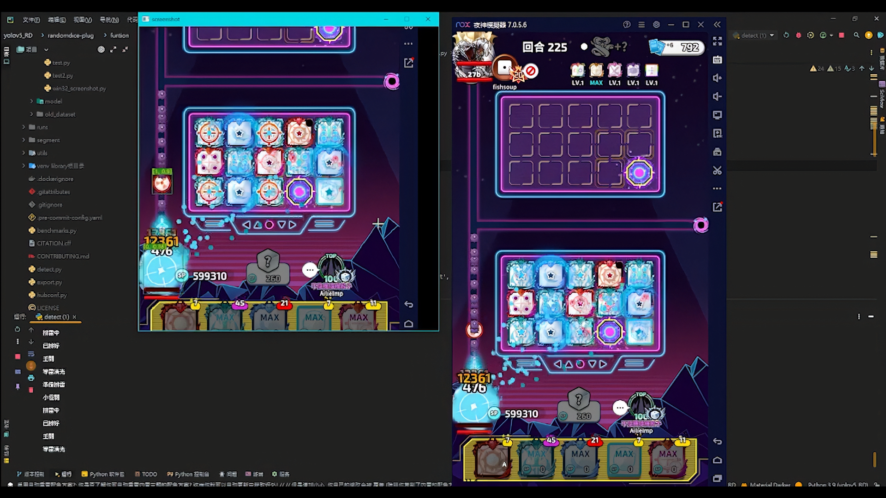

# NonRandomDice

**讓骰子不再隨機——用自己訓練的物件偵測模型即時讀懂遊戲畫面，在正確的時機引爆地雷。**

一套跑在本機的即時電腦視覺控制系統：螢幕擷取 → YOLOv5 推論 → 狀態機決策 → 視窗訊息控制，全程不佔用滑鼠與前景焦點。




> 開發於 2023 年 1～3 月寒假。純技術紀錄，不保證現在仍可運作。

---

## 這個專案在解決什麼

《Random Dice》的地雷骰子不是放下去就會生效的——它需要在對的時機手動引爆，而「對的時機」取決於畫面上正在發生什麼：現在是小怪關還是王關、地雷排到哪個位置了、Boss 有沒有被打到。

這件事沒有 API 可以問，唯一的資訊來源就是**畫面本身**。所以整個專案的核心問題其實是：

> 如何讓程式「看懂」一個它無法讀取內部狀態的即時畫面，並據此做出有時序性的決策？

答案是自己標資料、訓練一個只認三種東西的偵測模型，再用狀態機把「看到什麼」轉換成「該按什麼」。

## 系統架構

三個獨立行程並行，以 Queue 傳遞資料——推論很吃時間，不能讓它卡住控制邏輯：

```
┌─────────────────┐   obj_data    ┌──────────────────┐
│  detect_img     │ ────Queue───► │   handle_data    │
│                 │               │                  │
│ Win32 擷取畫面   │               │ 聚合每幀偵測結果  │
│ YOLOv5 推論     │               │ 判斷波次切換      │
│ 逐物件送出結果   │               │ 選出最近的地雷    │
│ 777 標記幀結束   │               │ 驅動狀態機        │
└─────────────────┘               └────────┬─────────┘
         ▲                                 │
         │ start                           │ WM_CHAR
┌────────┴────────┐                        ▼
│ input_listener  │               ┌──────────────────┐
│                 │   f_start     │  遊戲視窗（背景）  │
│ Home 啟動       │ ────Queue───► │                  │
│ F1  開關切換     │               └──────────────────┘
└─────────────────┘
```

## 實作重點

### 自建資料集，只訓練三個類別

模型不需要認得整個遊戲，只需要認得會影響決策的三種東西：

| 類別 | 意義 | 用途 |
|:--|:--|:--|
| `landmine` | 地雷骰子 | 判斷排雷進度、選出最前面那顆 |
| `wave` | 波次指示 | 區分小怪關與王關 |
| `boss-hit` | Boss 被擊中 | 確認地雷真的打到目標 |

類別少、場景固定，因此用 `yolov5s` 這種小模型就足夠，換來的是能在本機即時推論的速度。推論以 FP16 執行，信心閾值 0.65。

### 用視窗訊息控制，不搶滑鼠也不用切到前景

一般的自動化會用 `pyautogui` 移動滑鼠點擊，代價是遊戲必須在最上層、而且你不能同時做別的事。這裡改成直接對視窗發送訊息：

```python
win32gui.SendMessage(hwndTool, win32con.WM_CHAR, ord(key), 0)
```

`hwndTool` 是從模擬器視窗往下找到的 `toolbar_nox` 子視窗 handle。訊息直接送進訊息佇列，所以**遊戲可以待在背景**，滑鼠鍵盤也還是你的。

### 畫面擷取準備了兩種實作

| 方式 | 做法 | 特性 |
|:--|:--|:--|
| `win32_sct` | `GetWindowDC` + `BitBlt` 從視窗 DC 直接複製 | 可擷取**被遮住或在背景**的視窗 |
| `mss_sct` | MSS 抓螢幕指定矩形 | 快，但只能抓螢幕上看得到的內容 |

專案最終使用 Win32 版本，因為它才能配合「遊戲在背景執行」這個目標。

### 決策是一台由畫面驅動的狀態機

控制邏輯不是「看到地雷就按」，而是四個狀態的循環，每次轉移都需要畫面條件成立：

```
準備排雷 ──(小怪關 & 偵測到地雷)──► 排雷中
    ▲                                   │
    │                            (地雷推進到 y ≥ 290)
    │                                   ▼
 等雷清光 ◄──(王關 & Boss 被擊中)── 已排好
```

把狀態獨立出來的好處是：同一個畫面在不同狀態下會有不同反應，不會因為連續幾幀都看到地雷就狂按。

### 波次判斷用時間差去抖動

`wave` 標記在畫面上會連續出現好幾幀，如果每次偵測到就切換波次，狀態會亂掉。這裡用時間間隔過濾：

```python
wave_time_delay = time.time() - wave_time
if wave_time_delay > 10:
    wave = wave * (-1)   # 在小怪關 / 王關之間切換
```

10 秒內的重複偵測視為同一次波次切換。用 `* (-1)` 在兩個狀態間翻轉，比維護一個計數器簡潔。

### 每幀結束以哨兵值標記

偵測行程是逐物件把結果放進 Queue 的，接收端需要知道「這一幀送完了」才能開始整幀的綜合判斷。這裡用 `777` 當哨兵：

```python
for *xyxy, conf, cls in reversed(det):
    obj_data.put([int(cls), xywh])
obj_data.put(777)          # 幀結束
```

接收端讀到 `777` 就跳出內層迴圈，開始用這一幀的完整資訊做決策。

### 選最前面的地雷

同時存在多顆地雷時，要判斷的是**最接近終點**的那一顆。以畫面左下角 `(0, 640)` 為參考點計算歐氏距離，取最小者：

```python
distance = round(math.sqrt(((x - 0) ** 2) + ((y - 640) ** 2)), 2)
if not distance_min or distance < distance_min:
    distance_min = distance
    target_first = y
```

## 目前範圍與後續方向

- **綁定夜神模擬器**：靠視窗標題「夜神模擬器」與子視窗 `toolbar_nox` 取得 handle，換模擬器就要重寫 `get_hwnd`。
- **座標與閾值寫死**：擷取區 `(0, 335, 640, 640)`、地雷判定線 `y >= 290`、距離參考點 `(0, 640)` 都是對著特定解析度調出來的，換視窗大小即失效。應抽成設定檔。
- **模型路徑是相對路徑**：`detect.py` 以 `'../../runs/train/exp13/weights/best.pt'` 載入，只有從特定目錄執行才找得到。`randomdice-plug/model/best.pt` 是同一個模型 strip 掉 optimizer 後的推論版，指向它會更穩。
- **訓練成效未保留**：`runs/train/` 下各實驗只留了 `hyp.yaml` 與 `opt.yaml`，YOLOv5 產生的 loss 曲線、PR 曲線、混淆矩陣沒有一併保存，現在無法回溯各次訓練的實際表現。
- **`funtion` 是 `function` 的拼字錯誤**：目錄名沿用當時的誤植，未更名以免破壞既有的 import 路徑。
- **與遊戲版本耦合**：模型認的是 2023 年的遊戲畫面，介面改版後需要重新標註與訓練。

## 專案結構

```
randomdice-plug/                 本專案
├── funtion/
│   ├── detect.py                主程式：擷取 → 推論 → 分派三個行程
│   ├── handle.py                聚合每幀結果、波次判斷、驅動狀態機
│   ├── landmine_control.py      地雷狀態機
│   ├── mouse_control.py         視窗訊息送鍵、全域快捷鍵監聽
│   ├── get_hwnd.py              列舉視窗、取得模擬器與工具列 handle
│   ├── win32_screenshot.py      BitBlt 擷取（可抓背景視窗）
│   └── mss_screenshot.py        MSS 擷取（螢幕區域）
├── dataset/
│   ├── train/ · valid/          自建標註資料集
│   └── class-hit.yaml           三類別定義
├── model/
│   ├── best.pt                  訓練完成的推論模型
│   └── yolov5s.pt               預訓練權重
└── old_dataset/                 早期資料集（保留備查）

runs/train/exp … exp13           13 次訓練的超參數與權重

utils/ · models/ · train.py · val.py · export.py · data/hyps/
                                 YOLOv5 框架中本專案實際依賴的部分
```

> 本 repo 保留了 YOLOv5 框架中被直接或間接 import 的模組；官方的分類／分割範例、匯出與基準測試腳本、CI 設定與其他資料集定義已移除，以減少與本專案無關的內容。

## 執行

```bash
pip install -r requirements.txt
```

額外需要：`pywin32`、`pynput`、`mss`、`opencv-python`。

1. 開啟夜神模擬器並進入遊戲
2. 執行 `python funtion/detect.py`
3. 按 `Home` 啟動、`F1` 隨時開關

### 重新訓練

```bash
python train.py --data randomdice-plug/dataset/class-hit.yaml --weights yolov5s.pt --img 640
```

## 說明

這是一個為了練習即時物件偵測與系統整合而做的個人專案，內容保留當時的原貌。遊戲自動化工具通常牴觸遊戲本身的服務條款，此處公開的用意是記錄技術作法，不建議實際用於線上對戰。

本專案基於 [YOLOv5](https://github.com/ultralytics/yolov5)（AGPL-3.0）。
